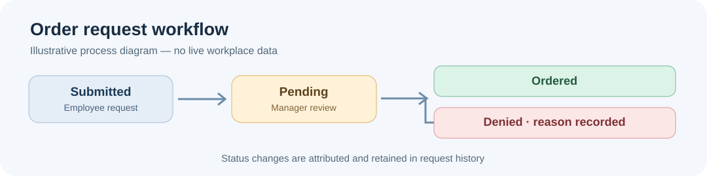
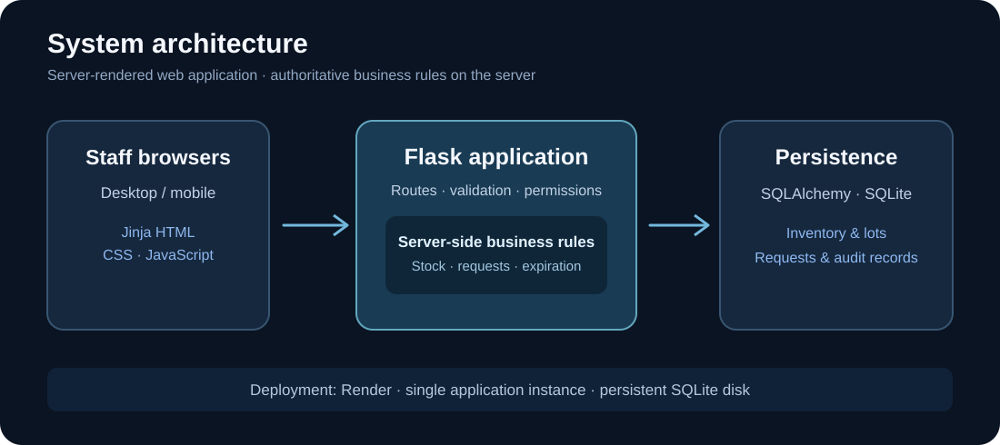

# Catering Stock Portal

**An internal inventory and order-coordination web application developed for a university catering workplace.**

**Role:** Lead storekeeper and primary project developer · **Stack:** Python, Flask, SQLAlchemy, SQLite, Jinja, JavaScript, CSS, pytest · **Source:** Private workplace repository

> **About this repository:** This is a public, documentation-only showcase of a privately maintained application. It contains no application source code, production data, credentials, or deployment configuration. The features described below are grounded in the deployed application snapshot; this is not a repository for running the system.

## The problem

Catering staff work across multiple physical storage locations while coordinating product requests, inventory adjustments, and upcoming events. When stock information and purchasing needs are scattered across informal communication and manual records, it is difficult to maintain a shared view of what is needed and what is available.

I helped turn those operational needs into a browser-based portal that gives staff a common place to **track inventory and submit requests**, and gives authorized staff a way to review and act on them. The **order-request workflow** has been the clearest practical success reported from workplace use. The broader inventory-tracking workflow has faced adoption challenges; I do not claim that the application eliminated manual inventory work or solved every operational issue.

## What the deployed application does

| Area | Implemented behavior |
| --- | --- |
| **Order coordination** | Employees submit requests for existing or new products; authorized staff mark requests as ordered or deny them with a reason. Request status changes retain an audit trail. |
| **Inventory tracking** | Separate physical inventories, item-level counts, minimum thresholds, stock reception/removal, manual count corrections, and item history. |
| **Stock availability** | Distinguishes total physical stock, expired stock, event reservations, and stock available for general use. Reservation shortages are surfaced without silently altering the reservation. |
| **Expiration control** | Tracks inventory lots, uses first-expiring-first-out stock allocation, and records expiration-date corrections separately from actual stock movement. |
| **Work requests** | Supports stock checks, inventory transfers, and defrost requests alongside ordering. |
| **Account administration** | Database-backed roles and capabilities, user-specific permission overrides, authenticated workflows, and access/audit records. |

The portal has been deployed for real workplace use. The application is also being maintained and revised, but **this showcase deliberately describes the capabilities evidenced in the supplied deployed-code snapshot, not unreleased functionality**.

## Engineering highlights

### Modeling physical stock versus usable stock

A recorded quantity is not necessarily available to use. Expired items remain physically present until discarded, while some qualifying stock is reserved for planned events. The server therefore maintains separate concepts for physical stock, qualifying stock, reserved stock, general availability, and reservation shortage.

This prevents a simple on-hand total from overstating what staff can use for everyday catering operations. The calculations are performed on the server and presented consistently across the interface.

### Preserving auditability across different operations

Receiving stock, correcting a physical count, discarding product, and correcting a lot's expiration date are different business events. The application represents those differences rather than treating every edit as an interchangeable quantity change.

In particular, changing an expiration date preserves the existing lot and quantity while recording the correction and its reason. Order status changes are also attributed and retained in request history.

### Designing authorization around capabilities

The application includes configurable roles and permission assignments, plus individual allow/deny overrides. Operational actions such as managing requests, changing stock, and administering access can be authorized separately. This is more maintainable than assuming a person's job title alone determines what they can do.

### Maintaining a real workplace system

The work involved more than implementing forms: understanding how staff actually track supplies, translating that into workflows, evaluating edge cases, deploying the portal, and revising designs in response to real use. The Orders workflow is an example of a feature that became useful when management incorporated checking requests into its routine.

## Architecture

The system uses a **single Flask application** with Jinja-rendered pages and vanilla JavaScript/CSS. SQLAlchemy models map operational records to a **SQLite database**. It is deployed on Render with persistent SQLite storage and a single application instance.

Server-side code is the source of truth for stock calculations, validation, and authorization. Client-side JavaScript supports interaction and display rather than independently deciding whether stock is available.

The design favors a relatively small, understandable stack over infrastructure that the workplace does not require.

## My contribution and development approach

I work within the catering operation and have served as its lead storekeeper. That gave me firsthand knowledge of the problems being addressed and direct access to the people using the software. I was the **primary developer and a principal driver of its requirements and design decisions**, including inventory semantics, request workflows, access-control considerations, and the tradeoffs involved in maintaining the deployed system.

This was **collaborative and extensively AI-assisted development**, not an entirely hand-written solo codebase. I used AI coding tools to accelerate implementation while shaping requirements, evaluating proposed solutions, making design decisions, arranging tests, inspecting behavior, and handling ongoing development and deployment work. Other contributors also participated. I do not claim exclusive authorship of every component or algorithm.

I have also worked on a separate, locally tested inventory-data rebuild. That work is intentionally **not presented here as deployed functionality**. My ongoing technical goal is to deepen my understanding of the entire implementation and refactor code where that improves maintainability, without misrepresenting work I have not yet done.

## Evidence and limitations

- **Real operational setting:** Built for a workplace where I also perform stockkeeping duties; some development work was performed as paid employment.
- **Deployed application:** The project has been used internally, rather than existing solely as a class demonstration.
- **Verified implementation:** The private code snapshot contains the features described above and an automated pytest suite.
- **Observed outcome:** The Orders workflow is the strongest reported area of workplace adoption.
- **What is not claimed:** No independently measured time savings, reduction in inventory discrepancies, deployment-scale benchmark, or universal employee adoption.

This showcase does not include a supervisor endorsement, employee information, internal operational records, or screenshots that might expose workplace data. Any future visual materials will use sanitized or synthetic records and will be added only when suitable for publication.

---

**Source availability:** The application source remains private because it was developed for workplace use. This repository documents the project and my engineering responsibilities; it is not a distribution of the underlying software.
